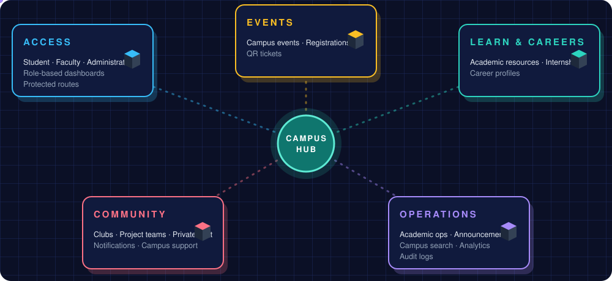
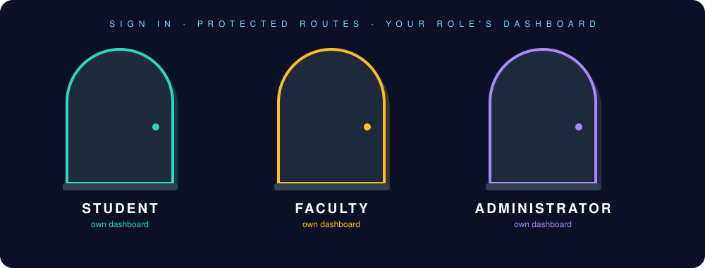
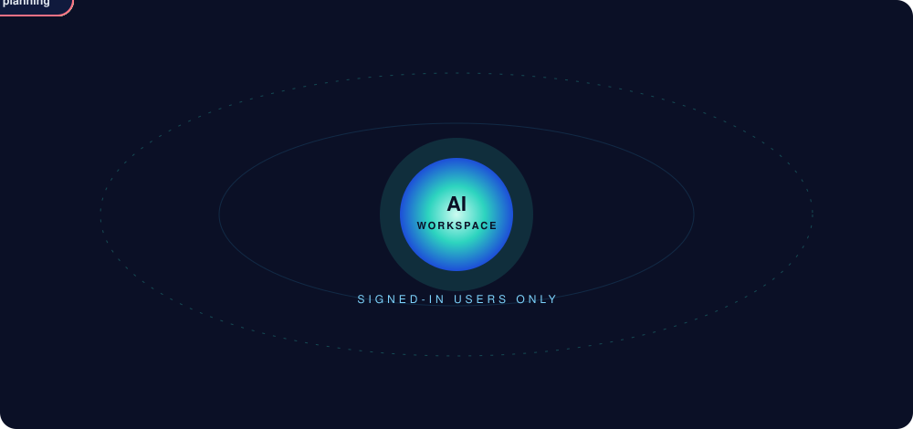
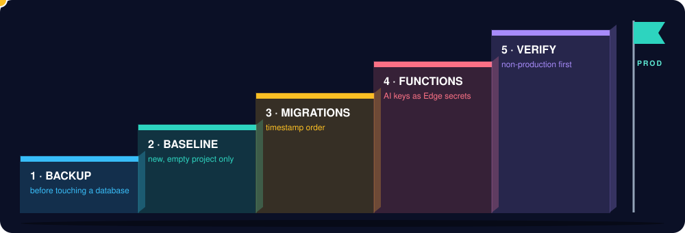
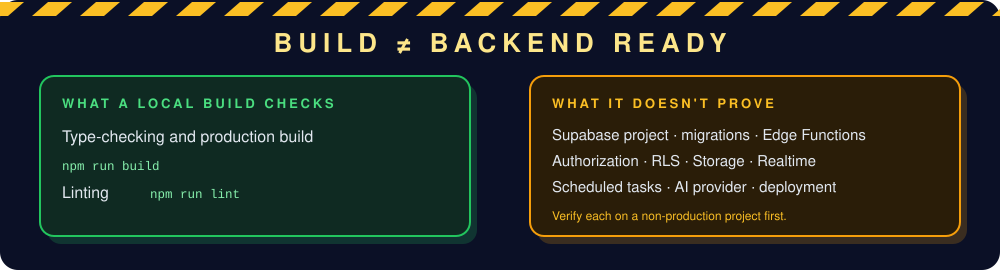

<!-- CAMPUSCONNECT AI | DIGITAL CAMPUS README -->

<div align="center">



<a href="https://github.com/SyedRaqi/CampusAI">
  
</a>

<br/>

<a href="#-campus-atlas"></a>
&nbsp;
<a href="#-the-ai-study-hall"></a>
&nbsp;
<a href="#-move-in-day"></a>
&nbsp;
<a href="#%EF%B8%8F-honest-status"></a>

<br/><br/>


</div>


## 🎓 Orientation Day

> **Welcome to CampusConnect AI.**

It's a React 19, TypeScript, Vite, and Supabase application for **campus operations, learning, careers, and student collaboration**, built for Anjuman Institute of Technology.

One thing to know before you wander in: CampusConnect AI extends the existing **Phases 1–10**. It is **not a separate chatbot application**. The AI workspace is one more room in a campus that already runs on events, clubs, resources, and dashboards.

## 🗺️ Campus Atlas

<div align="center">

</div>

<br/>

<details open>
<summary><b>📋 Full capability list, straight from the code</b></summary>

<br/>

- Student, faculty, and administrator authentication, role-based dashboards, and protected routes
- Campus events, registrations, QR tickets, academic resources, internships, and career profiles
- Clubs, project teams, private chat, notifications, and campus support
- Academic operations, announcements, campus search, analytics, and audit logs
- An authenticated AI workspace for campus Q&A/search, study plans, quizzes, notes, summaries, career guidance, roadmaps, interview practice, and project planning

</details>

## 🚪 Three Doors In

<div align="center">

</div>

Students, faculty, and administrators each sign in through their own door and land on a role-based dashboard. Protected routes keep every room behind the right key.

## 🧠 The AI Study Hall

<div align="center">

</div>

<br/>

The AI workspace is **authenticated**, so only signed-in users get in. Nine tools orbit it: campus Q&A and search, study plans, quizzes, notes, summaries, career guidance, roadmaps, interview practice, and project planning.

> 🔐 **House rule:** the AI provider key lives in Supabase Edge Function secrets. It never goes in browser code, `.env.local`, or any `VITE_*` variable.


## 🚌 Move-In Day

<div align="center">

</div>

<br/>

**Requirements:** Node.js supported by the installed Vite version, and npm.

**Stop 1 · Install, and Stop 2 · Configure**

```powershell
npm ci
Copy-Item .env.example .env.local
```

Set `VITE_SUPABASE_URL` and either `VITE_SUPABASE_PUBLISHABLE_KEY` or `VITE_SUPABASE_ANON_KEY` in `.env.local`. These are browser-facing Supabase project settings. **Do not put a service-role key or AI provider key in a `VITE_*` variable.** `.env.local` is ignored by Git.

**Stop 3 · Run**

```powershell
npm run dev
```

**Stop 4 · Check**

```powershell
npm run build
npm run lint
```

`npm run build` type-checks and production-builds the app. `npm run lint` runs the configured linter. There is currently **no automated test script or test framework** in `package.json`.

## 🪜 Backend Bring-Up

<div align="center">

</div>

<br/>

1. **Back up.** Create or select the intended Supabase project and take a backup before changing an existing database.
2. **Baseline.** For a **new, empty** project, establish the baseline in [`supabase/schema.sql`](supabase/schema.sql) once. Do not blindly reapply this baseline to an existing project; review its schema and migration history first.
3. **Migrate.** Apply versioned SQL migrations in timestamp order from [`supabase/migrations/`](supabase/migrations). The Phase 11 security migration prevents self-service role escalation and adds chat messages to the Realtime publication.
4. **Deploy functions.** Deploy the authenticated Edge Functions and configure AI credentials as Supabase Edge Function secrets. Follow [`docs/AI_SETUP.md`](docs/AI_SETUP.md); never put the provider key in browser code or `.env.local`.
5. **Verify.** Check authorization, RLS, Storage, Realtime, scheduled tasks, and the AI provider against a non-production project before production rollout.


## 📐 Campus Blueprint

<div align="center">

</div>

<br/>

| 🏛️ BUILDING | 📍 WHAT'S INSIDE |
|---|---|
| `src/` | Application UI, routes, contexts, and Supabase-backed services |
| `supabase/schema.sql` | Core schema and baseline policies |
| `supabase/migrations/` | Phased, versioned database changes |
| `supabase/functions/` | Edge Function handlers and shared server-side AI utilities |
| `docs/` | AI setup, phase setup guides, and readiness checklists |

## ⚠️ Honest Status

<div align="center">

</div>

<br/>

This inventory reflects code in the repository. It does not imply that a Supabase project, its migrations, Edge Functions, or production deployment have been configured or tested. See [the Phase 11 readiness report](docs/PHASE11_READINESS.md) for verified checks and remaining deployment gates.

Live project setup, migration state, and deployment status are not verified by a local build. **Do not treat a successful frontend build as evidence that the Supabase backend is ready.**

## 📚 The Handbook

| 📖 GUIDE | 🎯 USE IT FOR |
|---|---|
| [AI setup and Edge Function deployment](docs/AI_SETUP.md) | Getting the AI workspace's server side running |
| [Phase 11 inventory, security findings, and deployment gates](docs/PHASE11_READINESS.md) | What's verified, and what's still blocking production |
| [Campus support setup](docs/CAMPUS_SUPPORT_SETUP.md) | Setting up campus support |

<div align="center">


**CampusConnect AI** · Built by [Syed Raqi](https://github.com/SyedRaqi) · [⭐ Star the repo](https://github.com/SyedRaqi/CampusAI)

<sub>AI-powered campus management and student collaboration platform for Anjuman Institute of Technology.</sub>

</div>
